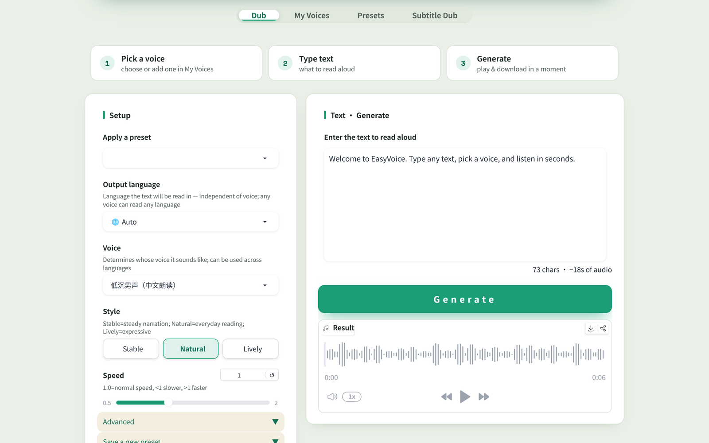

# EasyVoice (易声)

> Local multilingual dubbing and voice cloning — record a clip, then read any text aloud.

   

[⬇ Download Bundle](../../releases/latest) · [🇨🇳 China Mirror](https://alist.newzone.top:9003/apps/EasyVoice) · [简体中文](README.md)

Zero setup required — unzip and double-click to launch in your browser. Powered by Qwen3-TTS for 10-language voice cloning and subtitle dubbing, running entirely offline with automatic CUDA acceleration and CPU fallback.

## Supported

| Dimension | Supported scope & notes |
|---|---|
| **Operating System** | Windows 10/11 (all-in-one bundle); macOS / Linux (run from source) |
| **Hardware** | NVIDIA GPU (auto CUDA acceleration, 0.6B / 1.7B models); CPU fallback (0.6B model) |
| **Languages** | Chinese, English, Japanese, Korean, German, French, Russian, Portuguese, Spanish, Italian (10 languages, auto-detect by default) |
| **Subtitles** | SRT, VTT, LRC (auto speaker-prefix detection; assign a voice per character) |
| **Reference Audio** | WAV, MP3 and common audio formats (~5–15s of clean single-speaker voice recommended) |
| **Video Muxing** | MP4 container (supports "replace audio" or "keep background audio with ducking") |
| **Network** | 100% offline local inference, zero data uploaded. The full bundle ships the model and runs without internet; the CPU lite bundle and first use of 1.7B need internet to download the model |

## What it does

- **Voice cloning** — Upload or record ~10s of clean speech to clone any voice for speech synthesis and subtitle dubbing.
- **Multilingual dubbing** — 10 languages (Chinese, English, Japanese, Korean, German, French, Russian, Portuguese, Spanish, Italian) with auto-detection.
- **Multi-speaker subtitle dubbing** — Import SRT / VTT / LRC; speakers are detected automatically and you assign a voice per character, with per-line preview, editing, re-rolling, and timeline alignment. Only have video? Use [funasr-subtitle](https://github.com/rockbenben/funasr-subtitle) to extract subtitles first.
- **Direct video export** — Built-in muxing pipeline outputs a finalized MP4 video with synced dubbing and aligned subtitles.
- **Trilingual UI & remembered presets** — Simplified Chinese / Traditional Chinese / English, auto-detected from the browser, with local persistence for voice, speed, and style settings.

## Quick start

### 1. Download

Grab a bundle from **[Releases](../../releases/latest)** (or the **[China Mirror](https://alist.newzone.top:9003/apps/EasyVoice)**):

| Bundle | Size | Recommended hardware | Model |
|---|---|---|---|
| **Full bundle** (GPU / CPU auto) | ~4.6 GB (3 volumes) | NVIDIA GPU / fast generation | Bundled 0.6B model |
| **CPU lite bundle** | ~0.5 GB (single file) | No GPU / lightweight download | Auto-downloads model on first launch (~2.3 GB) |

- **Full bundle**: Put all three parts (`.zip.01`, `.zip.02`, `.zip.03`) and `merge-and-extract.bat` in the same directory, then double-click the bat to merge and extract.
- **CPU lite bundle**: Download the `-cpu` zip and extract.

### 2. Launch

In the extracted folder, double-click **`Start EasyVoice.bat`**. First launch initializes the runtime (~1 min) and then loads the model (~30s); the CPU lite bundle also downloads the model first (~2.3 GB).

> [!NOTE]
> To quit the service, close the command prompt window, or click the on-page "Quit" button in the bottom right corner (closing the browser tab alone does not stop the background process).

### 3. Generate your first clip

A browser tab will automatically open at `http://127.0.0.1:7860` (if the port is taken or reserved by the system, the next available one is used):

1. **Text dubbing**: Type your text in the Text dubbing tab, select a voice and language, and click "Generate";
2. **My Voices**: Upload or record a short voice clip to add it to your voice library;
3. **Subtitle Dub**: Drop in an SRT/VTT/LRC subtitle file, assign voices to detected speakers, generate audio, and optionally mux it straight into your original video.

### Upgrading an existing install

Each bundle extracts into its own folder. When upgrading, **keep your old directory first**:

1. Quit the running old version;
2. Unzip the new bundle into a new folder;
3. Copy `voices/` (voice library), `presets/` (presets and key), and `outputs/` (generated results) from the old folder to the same place in the new one. On the CPU lite bundle, copy `models/` as well to skip re-downloading. Verify that the new version works properly before deleting the old folder.

## Limitations

- **CPU generation is slow** — CPU inference takes ~20–40s per sentence (minutes for paragraphs); best for testing and short clips. For fast long-form dubbing, an NVIDIA GPU is recommended.
- **Voice clone fidelity depends on reference audio** — Use 5–15 seconds of clean, single-speaker audio without background music or heavy reverb; background noise will degrade output timbre.
- **Long text is automatically chunked** — Passages exceeding 200 characters are automatically split by punctuation and assembled with 0.25s natural pauses. For long scripts, the Subtitle Dub tab is recommended for cue-level timing control.

## Running from source

For Linux / macOS usage, secondary development, or custom builds, see **[DEVELOPMENT.en.md](DEVELOPMENT.en.md)**. For system design and architecture decisions, see **[docs/ARCHITECTURE.md](docs/ARCHITECTURE.md)**.

## Changelog

Per-release notes live on [Releases](../../releases/latest); source changes that are not in a bundle build yet are listed in [CHANGELOG.en.md](CHANGELOG.en.md).

## License & Credits

- EasyVoice code is licensed under the **[MIT License](LICENSE)**.
- Speech synthesis is powered by **[Qwen3-TTS](https://github.com/QwenLM/Qwen3-TTS)** (Apache License 2.0).
- Third-party component licenses in all-in-one bundles are documented in **[THIRD-PARTY-NOTICES](assets/packaging/THIRD-PARTY-NOTICES.txt)**.

## About the 365 Open Source Plan

Project **#018** of the [365 Open Source Plan](https://github.com/rockbenben/365opensource) — one person + AI, 300+ open-source projects in a year.

[Submit your idea →](https://365.aishort.top/) · [Discord](https://discord.gg/PZTQfJ4GjX) · [Telegram](https://t.me/aishort_top)
