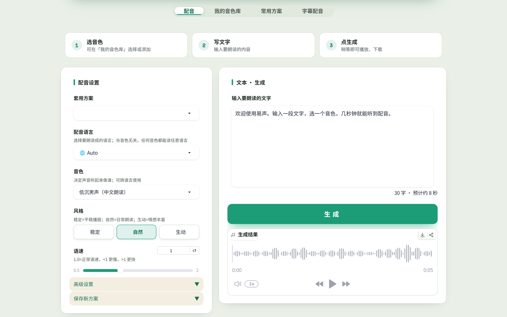

# 易声 (EasyVoice)

> 基于 Qwen3-TTS 的本地多语言配音与声音克隆工具，录一段声音即可朗读任意文本

   

[⬇ 下载整合包](../../releases/latest) · [🇨🇳 国内高速下载](https://alist.newzone.top:9003/apps/EasyVoice) · [English](README.en.md)

无需复杂配置，解压双击即可在浏览器本地运行。利用 Qwen3-TTS 实现 10 种语言的声音克隆与字幕配音，全程本地推理、不传云端，有显卡自动开启 CUDA 加速，无显卡自动降级 CPU。

## 支持范围

| 维度 | 支持范围与说明 |
|---|---|
| **操作系统** | Windows 10/11（解压即用整合包）；macOS / Linux（通过源码运行） |
| **硬件加速** | NVIDIA 独立显卡（自动启用 CUDA 加速，可选 0.6B / 1.7B 模型）；无显卡自动降级 CPU（固定 0.6B） |
| **支持语种** | 中文、英语、日语、韩语、德语、法语、俄语、葡萄牙语、西班牙语、意大利语（共 10 种，默认自动检测） |
| **字幕格式** | SRT、VTT、LRC（可自动识别说话人前缀，并按角色分别指定音色） |
| **参考音频** | WAV、MP3 等主流音频格式（建议 5–15 秒清晰单人人声，无背景杂音） |
| **视频合成** | MP4 视频封装（支持「替换原声」与「保留原声并压低音量混音」两种模式） |
| **网络需求** | 全程本地离线推理，不上传任何音频与文本；完整大包内置模型可断网运行，CPU 精简包首次启动与首次使用 1.7B 时需联网下载模型 |

## 能做什么

- **声音克隆** —— 上传或录制一段 10 秒左右清晰人声，快速克隆目标音色，用于任意文本朗读与字幕配音。
- **多语种配音** —— 覆盖中、英、日、韩、德、法、俄、葡、西、意 10 种语言，支持自动语种识别或手动锁定。
- **多角色字幕配音** —— 导入 SRT / VTT / LRC 字幕，自动识别说话人并按角色分别指定音色，支持逐句试听、改词、重录并对齐时间轴。手头没有字幕时，可搭配 [funasr-subtitle](https://github.com/rockbenben/funasr-subtitle) 先行转录。
- **一键成片合成** —— 内置音视频合成管道，直接输出配音对齐的最终 MP4 成片与调准后的字幕文件。
- **界面三语与参数记忆** —— 简体 / 繁體 / English 随浏览器语言自动切换，本地持久化保存常用音色、语速与风格参数。

## 快速开始

### 1. 下载整合包

前往 **[Releases](../../releases/latest)**（国内推荐 **[高速镜像](https://alist.newzone.top:9003/apps/EasyVoice)**）下载对应版本：

| 版本 | 体积 | 适用设备 | 模型配置 |
|---|---|---|---|
| **完整大包**（GPU / CPU 自适应） | ~5 GiB（分卷数见 Release） | NVIDIA 显卡 / 追求快速生成 | 内置 0.6B 模型，解压即用 |
| **CPU 精简包** | ~0.5GB（单文件） | 无显卡轻量试用 | 首次启动自动下载模型（~2.3GB） |

- **完整大包**：下载 Release 中的全部分卷（`.zip.01`、`.zip.02` 等），与 `merge-and-extract.bat` 放在同一目录，再双击 bat 合并解压。如果下载的是完整 ZIP，直接解压即可。
- **CPU 精简包**：下载文件名带 `-cpu` 的 zip，直接解压即可。

### 2. 双击启动

进入解压目录，双击运行 **`Start EasyVoice.bat`**。首次启动会先初始化运行时（约 1 分钟）再加载模型（约 30 秒）；CPU 精简包还需先下载模型（约 2.3GB）。

> [!NOTE]
> 退出服务请关闭弹出的命令行窗口，或在网页右下角点击「退出」按钮（仅关闭浏览器标签页服务仍会在后台常驻）。

### 3. 浏览器使用

服务启动后会自动打开 `http://127.0.0.1:7860`（端口被占用或被系统保留时自动顺延备用端口）：

1. **文本配音**：在「文本配音」页输入文字，选择参考音色与语种，点击「生成」即可试听与下载 WAV；
2. **音色管理**：在「我的音色库」上传或录制新声音，保存后即可在「文本配音」中调用；
3. **字幕配音**：在「字幕配音」页拖入字幕，为各角色指派音色，生成后可一键合进视频并导出成片。

### 升级已有版本

整合包解压即用，升级时**先保留旧版本目录**：

1. 关掉正在运行的旧版本服务；
2. 将新版本解压到独立新目录；
3. 将旧目录中的 `voices/`（音色库）、`presets/`（预设方案与设置密钥）、`outputs/`（生成记录）完整复制到新目录对应位置；CPU 精简包可一并复制 `models/` 省去重新下载。确认新版本正常运行后再删除旧目录。

## 限制与注意事项

- **CPU 模式生成速度较慢** —— CPU 推理约 20–40 秒朗读一句短句，长文本需数分钟，适合短句制作与效果预览；批量或长视频配音推荐使用带 NVIDIA 显卡的完整大包。
- **参考音频质量直接影响克隆效果** —— 建议使用 5–15 秒、无背景音乐、无混响、单人清晰发音的干声音频；嘈杂杂音或背景重叠会被一并拟合。
- **单条长文本自动切块** —— 超过 200 字的长段落会自动按标点智能分段合成后拼接（段间留 0.25 秒停顿），极长文本建议通过字幕配音模块分句精细控制。

## 从源码运行

如需在 Linux / macOS 运行、二次开发或自行打包，请查阅 **[DEVELOPMENT.md](DEVELOPMENT.md)**。架构设计与决策依据参见 **[docs/ARCHITECTURE.md](docs/ARCHITECTURE.md)**。

## 更新记录

各版本改动见 [Releases](../../releases/latest)；源码中尚未打进整合包的改动见 [CHANGELOG.md](CHANGELOG.md)。

## 许可证与致谢

- 本项目代码遵循 **[MIT License](LICENSE)**。
- 语音合成基于 **[Qwen3-TTS](https://github.com/QwenLM/Qwen3-TTS)**（模型权重遵循 Apache License 2.0）。
- 整合包内附带的第三方组件许可与来源声明见 **[THIRD-PARTY-NOTICES](assets/packaging/THIRD-PARTY-NOTICES.txt)**。

## 关于 365 开源计划

[365 开源计划](https://github.com/rockbenben/365opensource) 的第 **#018** 个项目——一个人 + AI，一年 300+ 个开源项目。

[提交你的需求 →](https://365.aishort.top/) · [Discord](https://discord.gg/PZTQfJ4GjX) · [Telegram](https://t.me/aishort_top)
